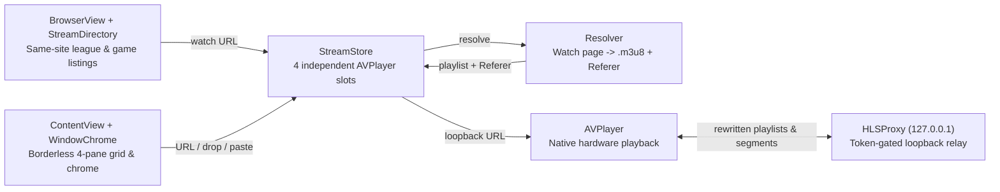

<div align="center">


# Crackstreams for macOS

**Watch up to four live HLS sports streams side by side in a native, borderless macOS player.**<br/>
Zero ads. Zero popups. Zero browser overhead.

[](https://github.com/nikships/crackstreams/releases/latest)
[](https://github.com/nikships/crackstreams/releases/latest)
[](https://github.com/nikships/crackstreams/actions/workflows/ci.yml)
[](https://github.com/nikships/crackstreams/blob/main/LICENSE)
[](https://github.com/nikships/crackstreams/stargazers)

**[Download Universal DMG](https://github.com/nikships/crackstreams/releases/latest)** · [Keyboard Shortcuts](#keyboard-shortcuts) · [Build from Source](#quick-start) · [Architecture](#architecture)

<br/>


</div>

## What is this?

Crackstreams is a native SwiftUI and `AVPlayer` client for macOS 14+ that resolves watch pages and direct `.m3u8` playlists into up to four simultaneous live video panes. It strips away browser tabs, ad overlays, fake player prompts, and chat sidebars by resolving the underlying HLS feed and playing it through a token-protected loopback relay.

Pick games from the built-in Live Sports Directory (`⌘B`), drag a URL onto any pane, or paste a stream link into the Add Stream palette (`⌘L`). No browser, streamlink, or mpv installation is required.

<div align="center">
  
</div>

## Features

- **Borderless MPV-style window**: Runs edge-to-edge without a gray system title bar. Each pane shows its own controls along its top edge on hover or keyboard focus, a small dock at the bottom switches panes and adds streams, and everything auto-hides during idle playback. Drag the window by any background or video surface.
- **Four-pane multiview**: Run 1 to 4 independent `AVPlayer` feeds simultaneously, expand any pane full-window (`⌘1`–`⌘4`), take one pane full screen with its full-screen button or a double-click on the video, or jump back to the 2×2 grid (`⌘0` or `Esc`).
- **Smart audio & one-click solo**: Pane 1 starts audible while additional panes start muted. Click a muted pane's speaker (or press `⌥⌘1`–`⌥⌘4`) to switch the sound to that game, or Option-click it to mix it with what is already playing. Audible panes get a per-pane volume slider.
- **Built-in Live Sports Directory (`⌘B`)**: Browse live, starting-soon, and 24/7 listings from `crackstreams.mx` with start times converted to your local time zone. Only same-site `/league/` and `/stream/` links are shown.
- **Add Stream palette & drag-and-drop (`⌘L`)**: Open the palette with `⌘L` or the dock's Add button, drop a link onto any pane to play or replace it, or paste straight from the clipboard.
- **Resilient & secure playback**: Temporary stalls display a non-destructive `Reconnecting…` pill instead of tearing down the player, and failures include an inline retry. Upstream `Referer` headers and playlist rewriting run inside a loopback-only relay gated by a random per-launch token and `Host` validation.
- **Universal & auto-updating**: Ships as a signed, notarized Apple silicon + Intel DMG with Sparkle EdDSA in-app updates.

## Keyboard Shortcuts

| Shortcut | Action |
|---|---|
| `⌘L` | Toggle the Add Stream palette (`Esc` to hide) |
| `⌘B` | Open Live Sports Directory |
| `⌘1` – `⌘4` | Expand or restore pane 1–4 |
| `⌘0` / `Esc` | Return to all four panes (and leave pane full screen) |
| Double-click video | Toggle full screen for that pane |
| `⌥⌘1` – `⌥⌘4` | Solo audio on pane 1–4 |

## Quick Start

### Install the App (Recommended)

1. Download the universal, notarized `.dmg` from the [Latest Release](https://github.com/nikships/crackstreams/releases/latest).
2. Open the disk image and drag **Crackstreams** into **Applications** (requires macOS 14 or later on Apple silicon or Intel).
3. Launch **Crackstreams**. Future updates arrive automatically via **Crackstreams › Check for Updates…** (Sparkle).

### Build from Source

Requires macOS 14+ and a Swift 6 toolchain. [Sparkle](https://sparkle-project.org) is the only package dependency and is fetched automatically by SwiftPM.

```bash
git clone https://github.com/nikships/crackstreams.git
cd crackstreams
swift test
./build.sh --install
```

`./build.sh --install` builds `dist/Crackstreams.app`, embeds `Sparkle.framework`, applies ad-hoc signing for local development, and installs it to `~/Applications/Crackstreams.app`.

## Architecture



- `Sources/StreamDirectory.swift`: Fetches and parses league and event listings, limiting results to same-site `/league/` and `/stream/` links and dropping stale responses when switching leagues.
- `Sources/Resolver.swift`: Extracts embeds and validates HTTP(S) HLS playlists with bounded payload sizes and task cancellation.
- `Sources/HLSProxy.swift`: Loopback-only HTTP relay on `127.0.0.1` that injects upstream `Referer` headers, supports byte ranges, and rewrites playlists, keys, and segments to local URLs protected by a per-launch token and `Host` check.
- `Sources/StreamStore.swift`: Manages four independent `AVPlayer` slots with generation guards, mute/solo state, buffering indicators, and inline retry.
- `Sources/ContentView.swift` & `Sources/PlayerView.swift`: Render the borderless 2×2 grid, per-pane hover/focus controls, the multiview dock, the Add Stream palette, and drag-and-drop targets.
- `Sources/WindowChrome.swift`: Configures the chromeless `NSWindow`, hover-only traffic lights, idle cursor auto-hide, video-surface window dragging, and double-click-to-full-screen.
- `Sources/BrowserView.swift`: Renders the Live Sports Directory modal sheet.
- `Sources/Updater.swift`: Integrates Sparkle automatic updates (disabled in debug builds).

## Project Structure

```text
crackstreams/
├── .github/
│   └── workflows/
│       ├── ci.yml
│       └── release.yml
├── Assets/
│   ├── AppIcon.iconset/
│   ├── AppIcon.icns
│   └── AppIcon.png
├── Config/
│   └── Entitlements.plist
├── Scripts/
│   ├── build-app.sh
│   ├── next-version.sh
│   ├── release.sh
│   └── update-appcast.sh
├── Sources/
│   ├── BrowserView.swift
│   ├── ContentView.swift
│   ├── CrackstreamsApp.swift
│   ├── HLSProxy.swift
│   ├── PlayerView.swift
│   ├── Resolver.swift
│   ├── StreamDirectory.swift
│   ├── StreamStore.swift
│   ├── Updater.swift
│   └── WindowChrome.swift
├── Tests/
│   ├── HLSProxyTests.swift
│   ├── ReleaseConfigurationTests.swift
│   ├── ResolverTests.swift
│   ├── StreamDirectoryTests.swift
│   ├── StreamStoreTests.swift
│   └── WindowChromeTests.swift
├── AGENTS.md
├── Info.plist
├── LICENSE
├── Package.resolved
├── Package.swift
├── README.md
├── appcast.xml
└── build.sh
```

## Documentation

| Resource | Description |
|---|---|
| [AGENTS.md](AGENTS.md) | Playback invariants, development commands, and live validation checklist |
| [Package.swift](Package.swift) | SwiftPM manifest and Sparkle dependency |
| [Info.plist](Info.plist) | Bundle configuration, macOS 14 minimum, and Sparkle EdDSA feed keys |
| [Config/Entitlements.plist](Config/Entitlements.plist) | App Sandbox and Sparkle XPC mach-lookup entitlements |
| [.github/workflows/ci.yml](.github/workflows/ci.yml) | Automated unit tests, app bundle build, and shell script checks |
| [.github/workflows/release.yml](.github/workflows/release.yml) | Universal Developer ID signing, notarization, DMG publishing, and appcast updates |
| [Scripts/release.sh](Scripts/release.sh) | Reproducible local release, notarization, and stapling script |

<details>
<summary><strong>Releases &amp; Code Signing Pipeline</strong></summary>

Every push to `main` touching app inputs (`Sources/`, `Package.swift`, `Package.resolved`, `Info.plist`, `Config/`, `Assets/`, `Scripts/build-app.sh`, or `Scripts/release.sh`) runs `.github/workflows/release.yml`:

1. Computes the next semantic version via `Scripts/next-version.sh` (one patch above the newest `vX.Y.Z` tag, or `CFBundleShortVersionString` in `Info.plist` if higher) with commit count as `CFBundleVersion`.
2. Runs `Scripts/release.sh` using an isolated keychain: unit tests, universal binary build, Developer ID signing with App Sandbox and hardened runtime, notarization, stapling, and `spctl` verification.
3. Signs the release ZIP with `SPARKLE_PRIVATE_KEY` (EdDSA) and publishes the DMG, ZIP, and checksums to GitHub Releases.
4. Verifies the published DMG download and commits the updated `appcast.xml` to `main`.

Required GitHub Actions secrets: `APPLE_DEVELOPER_CERTIFICATE_P12_BASE64`, `APPLE_DEVELOPER_CERTIFICATE_PASSWORD`, `APPLE_DEVELOPER_ID_APPLICATION`, `APPLE_ID`, `APPLE_APP_SPECIFIC_PASSWORD`, `APPLE_TEAM_ID`, and `SPARKLE_PRIVATE_KEY` (matching `SUPublicEDKey` in `Info.plist`).

To run the release pipeline locally (without publishing):

```bash
VERSION="$(bash Scripts/next-version.sh)" \
BUILD_NUMBER="$(git rev-list --count HEAD)" \
SIGN_IDENTITY="Developer ID Application: Your Name (TEAMID)" \
APPLE_ID="you@example.com" \
APPLE_PASSWORD="app-specific-password" \
APPLE_TEAM_ID="TEAMID" \
bash Scripts/release.sh
```

</details>

## Contributing

Contributions are welcome. Before opening a pull request, run the CI verification suite locally:

```bash
swift test
bash Scripts/build-app.sh
bash -n build.sh Scripts/*.sh
```

<a href="https://github.com/nikships/crackstreams/graphs/contributors">
  
</a>

## License

Crackstreams is an independent client and is not affiliated with any streaming site or broadcaster. Stream availability and site markup can change. Use it only with feeds you are authorized to access.

Released under the [MIT License](LICENSE).

---

<div align="center">

[](https://star-history.com/#nikships/crackstreams&Date)

</div>
