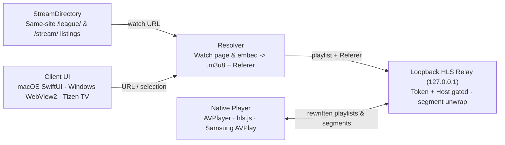

<div align="center">


# Crackstreams

**Watch live HLS sports streams in native, ad-free players across macOS, Windows, and Samsung Smart TV.**<br/>
Zero ads. Zero popups. Zero browser overhead.

[](https://github.com/nikships/crackstreams/releases/latest)
[](https://github.com/nikships/crackstreams/releases/latest)
[](https://github.com/nikships/crackstreams/releases/latest)
[](#samsung-smart-tv-tizen)
[](https://github.com/nikships/crackstreams/actions/workflows/ci.yml)
[](https://github.com/nikships/crackstreams/blob/main/LICENSE)

**[Download Latest Release](https://github.com/nikships/crackstreams/releases/latest)** · [macOS](#macos) · [Windows](#windows-10--11) · [Samsung Smart TV](#samsung-smart-tv-tizen) · [Architecture](#architecture)

<br/>


</div>

## What is this?

Crackstreams is a multi-platform suite of native sports stream players for **macOS**, **Windows 10/11**, and **Samsung Smart TV (Tizen 10)**. Each client resolves watch pages and direct `.m3u8` playlists into clean HLS feeds played through a token-protected `127.0.0.1` loopback relay—stripping away ad overlays, popups, fake player prompts, and chat sidebars.

- **macOS (`Sources/`)**: Native SwiftUI + `AVPlayer` 4-pane borderless multiview player, Developer ID notarized with Sparkle auto-updates.
- **Windows (`windows/`)**: Standalone single-executable (`Crackstreams.exe`) 4-pane player built in pure Go + Edge WebView2 with zero external runtime dependencies.
- **Samsung Smart TV (`tv/`)**: Standalone Tizen 10 TV widget + bundled on-TV Node HLS relay service driven by the TV remote and hardware `AVPlay`—no Mac or PC needs to stay on.

<div align="center">
  
</div>

## Features

- **Borderless MPV-style window (macOS & Windows)**: Runs edge-to-edge without chrome clutter. Each pane reveals controls on hover or keyboard focus, a bottom dock switches panes and adds streams, and controls auto-hide during idle playback.
- **Four-pane multiview**: Run 1 to 4 independent feeds simultaneously on desktop, expand any pane full-window (`⌘1`–`⌘4` / `Alt+1`–`Alt+4`), double-click for full screen, or return to the 2×2 grid (`⌘0` / `Esc`).
- **Smart audio & one-click solo**: Pane 1 starts audible while additional panes start muted. Click a muted pane's speaker to switch sound to that game, or Option-click to mix audio across panes.
- **Built-in Live Sports Directory**: Browse live, starting-soon, and 24/7 listings from `crackstreams.mx` with start times in your local time zone. Only same-site `/league/` and `/stream/` links are shown.
- **Standalone Samsung TV experience**: Navigate sports and live games with the TV remote's D-pad; streams stream directly through the TV's local loopback service with adaptive bitrate and live discontinuity recovery.
- **Resilient & secure playback**: Upstream `Referer` injection, segment unwrapping, and playlist rewriting run inside a loopback-only (`127.0.0.1`) relay gated by an unguessable per-launch token and `Host` validation.

## Keyboard Shortcuts (macOS)

| Shortcut | Action |
|---|---|
| `⌘L` | Toggle the Add Stream palette (`Esc` to hide) |
| `⌘B` | Open Live Sports Directory |
| `⌘1` – `⌘4` | Expand or restore pane 1–4 |
| `⌘0` / `Esc` | Return to all four panes (and leave pane full screen) |
| Double-click video | Toggle full screen for that pane |
| `⌥⌘1` – `⌥⌘4` | Solo audio on pane 1–4 |

## Quick Start

### macOS

1. Download `Crackstreams-<version>-universal.dmg` from the [Latest Release](https://github.com/nikships/crackstreams/releases/latest).
2. Open the disk image and drag **Crackstreams** into **Applications** (macOS 14+ on Apple silicon or Intel).
3. Future updates arrive automatically via **Crackstreams › Check for Updates…** (Sparkle).

To build from source (macOS 14+, Swift 6):

```bash
git clone https://github.com/nikships/crackstreams.git
cd crackstreams
swift test
./build.sh --install
```

### Windows (10 / 11)

1. Download `Crackstreams-Windows-x64.zip` (or `Crackstreams-Windows-arm64.zip`) from the [Latest Release](https://github.com/nikships/crackstreams/releases/latest).
2. Extract and double-click **`Crackstreams.exe`**—no installer or extra runtime needed on Windows 10/11.

To test and cross-compile from source (Go 1.23+):

```bash
(cd windows && go test -race ./...)
bash Scripts/build-windows.sh
```

### Samsung Smart TV (Tizen)

[`tv/`](tv) contains a standalone Tizen 10 widget (`Crackstreams.wgt`, also attached to each [GitHub Release](https://github.com/nikships/crackstreams/releases/latest)) with a remote-friendly live sports directory and hardware `AVPlay` playback. Everything runs directly on the TV without keeping a computer on.

```bash
node --test tv/tests/*.test.cjs
bash Scripts/build-tv.sh
```

See [`tv/README.md`](tv/README.md) for Partner certificate signing and sideloading onto your TV.

## Architecture



## Project Structure

```text
crackstreams/
├── .github/workflows/
│   ├── ci.yml                  # macOS, Windows, and Samsung TV CI
│   └── release.yml             # Notarized macOS + Windows + TV release publisher
├── Assets/                     # App icons
├── Config/
│   └── Entitlements.plist      # macOS App Sandbox & Sparkle entitlements
├── Scripts/
│   ├── build-app.sh            # Builds macOS Crackstreams.app
│   ├── build-tv.sh             # Packages Samsung TV Crackstreams.wgt
│   ├── build-windows.sh        # Cross-compiles Windows x64 & arm64 ZIPs
│   ├── next-version.sh         # Computes next semantic release version
│   ├── release.sh              # Signs, notarizes, and staples macOS artifacts
│   └── update-appcast.sh       # Updates Sparkle appcast.xml
├── Sources/                    # macOS SwiftUI + AVPlayer client
├── Tests/                      # macOS XCTest suite
├── tv/                         # Samsung Smart TV (Tizen 10) standalone client
│   ├── app/                    # Widget UI, AVPlay controller, loopback Node service
│   ├── tests/                  # Node unit tests & local preview harness
│   └── README.md               # Samsung TV signing & sideloading guide
├── windows/                    # Windows 10/11 Go + WebView2 standalone client
│   ├── cmd/crackstreams/       # Single-binary entrypoints & embedded icon resources
│   ├── internal/               # Directory, resolver, loopback HLS proxy, HTTP server
│   └── web/                    # Embedded 4-pane multiview UI
├── AGENTS.md
├── Info.plist
├── Package.swift
├── appcast.xml
└── build.sh
```

## Contributing

Before opening a pull request, run the full monorepo CI verification suite locally:

```bash
swift test
bash Scripts/build-app.sh
(cd windows && go test -race ./...)
bash Scripts/build-windows.sh
node --test tv/tests/*.test.cjs
xmllint --noout tv/app/config.xml
bash Scripts/build-tv.sh
for script in build.sh Scripts/*.sh; do bash -n "$script" || exit; done
```

<a href="https://github.com/nikships/crackstreams/graphs/contributors">
  
</a>

## License

Crackstreams is an independent client and is not affiliated with any streaming site or broadcaster. Stream availability and site markup can change. Use it only with feeds you are authorized to access.

Released under the [MIT License](LICENSE).

---

<div align="center">

[](https://star-history.com/#nikships/crackstreams&Date)

</div>
